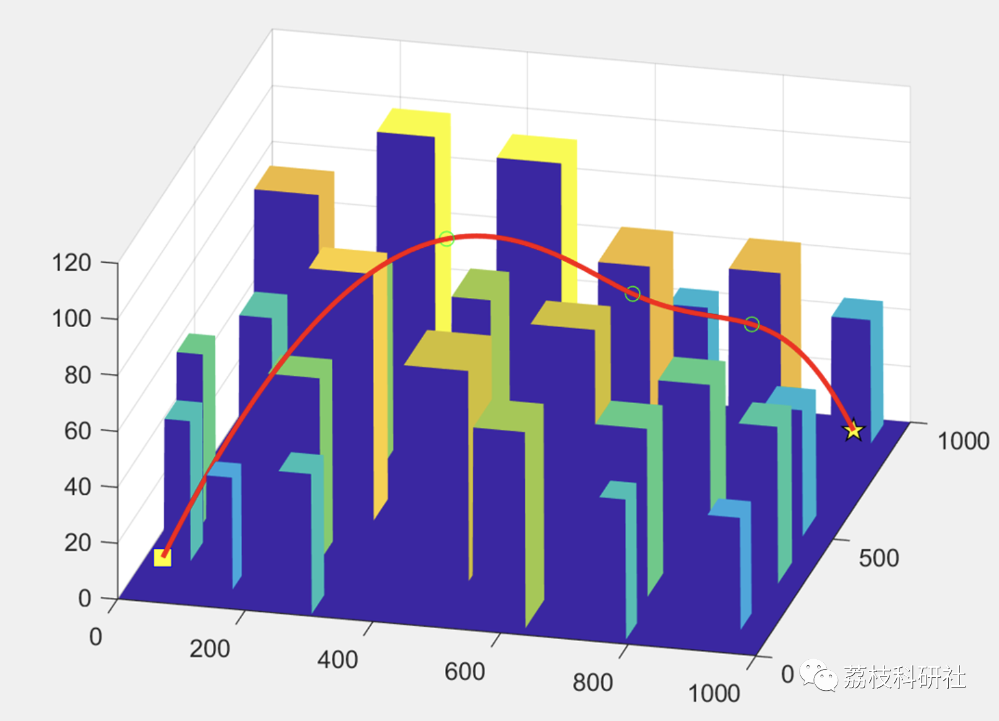

# Particle Swarm Optimization-Based Path Planning in 3D Animation (Matlab Code Implementation)

💥💥💥💞💞💞 Welcome to this blog❤️❤️❤️ 💥💥💥
🏆 Bloggers' Advantages: 🌞🌞🌞 The content of the blog strives for rigorous thinking and clear logic to facilitate readers.
⛳️ Mantra: A journey of a thousand miles is begun with a single step.
Litchi Research Society
Code Collection: Power Systems, Intelligent Algorithms and Applications, Neural Network Prediction, Path Planning, Optimized Scheduling, Workshop Scheduling, Image Processing, Signal Processing...
🎁 Special Section Links:
🌈🌈🌈🌟🌟🌟 Electrical Code Intelligent Algorithms and Their Applications Path Planning Neural Network Prediction Optimized Scheduling Image Processing Workshop Scheduling Signal Processing Romantic Her Thoughts My Philosophy Math Modelling Complete Code Issues
💥1 Overview
In response to the high requirements for consistency and individual independence in group movement trajectories, this paper proposes to improve the Particle Swarm Optimization algorithm and apply it to the path planning of three-dimensional group animation characters, generating individual motion paths to achieve realistic animation design aids.
📚2 Run Results
🎉3 References
[1] Wei Chao, Zhao Zhigang, Jiao Xiaofeng, Zhu Haidong, Zhang Lihui. Study on Short-Term Weather Forecast Based on Convolutional Neural Network [J]. Instrumentation User, 2021, 28(01):85-89+84.
🌈4 MATLAB Code Realization
Click the article's lower left corner to read more
​

## Images

<!-- PAYMENT_BLOCK -->

## Get this dataset

- Payment link (Stripe): [Buy now](https://buy.stripe.com/3cs8yP7sY87d0vu9AB)
- Payment QR code: 

<!-- /PAYMENT_BLOCK -->
